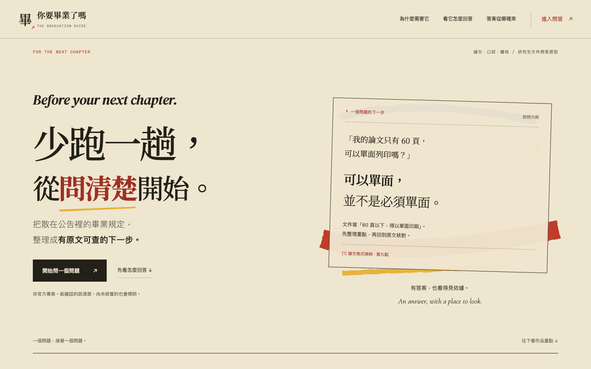
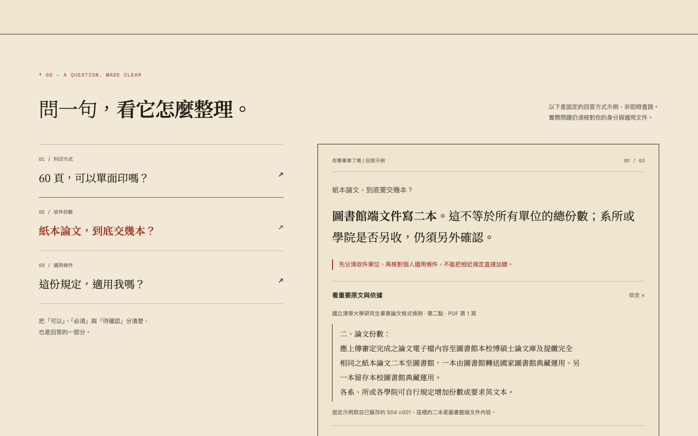

# 你要畢業了嗎 ↗

**把散在公告裡的畢業規定，整理成有原文可查的下一步。**

一個以研究生論文、口試與離校文件為起點的桌面問答原型。先整理答案，保留條件與例外；能接續追問，也能回到原文核對。



## 先看什麼

- **產品展示**：`static/index.html`，可切換三個回答示例、展開文件引文。
- **如何使用**：[使用說明](docs/usage.md)。
- **功能與範圍**：[產品介紹](docs/product-brief.md)。
- **如何運作**：[架構與資料流程](docs/architecture.md)。
- **檔案內容與執行限制**：[開發說明](docs/development.md)。

公開展示是固定示例與實際介面截圖，**不是已上線的自由問答客服**。完整語料、模型權重與正式向量庫沒有放在此儲存庫。

## 一分鐘看懂

| 使用者遇到的問題 | 產品怎麼處理 |
| --- | --- |
| 文件太多，不知道重點 | 先整理有依據的答案，再附條件、例外。 |
| 問完還有疑問 | 本機版同一聊天接續追問，不同聊天分開記憶。 |
| 不知道回答從哪來 | 引用連到文件片段，重要原文可展開核對。 |
| 規定可能不適用自己 | 標出適用性未知與文件衝突，不直接替使用者下結論。 |

## 本機開啟公開展示

需要 Python 3，無需 API key、套件安裝或模型下載：

```bash
python3 -m http.server 8080 --bind 127.0.0.1 --directory static
```

瀏覽 <http://127.0.0.1:8080/>。按「觀看問答展示」可閱讀導覽與本機實際截圖；頁面不會提交或儲存提問。



## 技術重點

本機原型使用 **BGE-large-zh-v1.5 + Chroma + 詞彙/向量混合檢索（RRF）**。文件按條文和語意單位切分，保留來源、定位與版本資訊。向量採 CLS pooling、L2 正規化與 cosine 距離；回答由證據規則整理，**沒有接入生成式語言模型來自由撰寫答案**。

`src/` 是經去除私人路徑的核心程式閱讀快照。它需要另備語料、索引及執行依賴；目前不是 clone 後即可跑完整 RAG 的發行包。公開靜態展示可直接依上方命令開啟。

## 驗證與界線

- 小範圍語料：31 原始片段、28 個正式檢索候選。
- 首輪評估主分母只有 10 題；融合的 Hit@1 較高，Complete@10 卻未超過詞彙檢索，詳見產品介紹。不能外推全校或宣稱向量全面勝出。
- 本機版此輪介面回歸：49 單元測試、12 隔離 HTTP 檢查；與公開匯出測試分開記錄。
- 非官方專案；個人年度與文件版本適用關係仍待核實。最終以權責單位公告及承辦確認為準。

## 素材與公開範圍

只包含產品介面、功能與技術說明、經選取的核心程式、測試及展示截圖。不包含個人面試稿、私人企劃草稿、聊天紀錄、內部協作紀錄、帳密、API key、本機環境、模型大檔、向量資料庫或校方完整文件。

字型與參考設計見 [第三方素材說明](THIRD_PARTY_NOTICES.md)。本專案原創程式目前未另行指定開源授權；第三方素材依各自授權。
