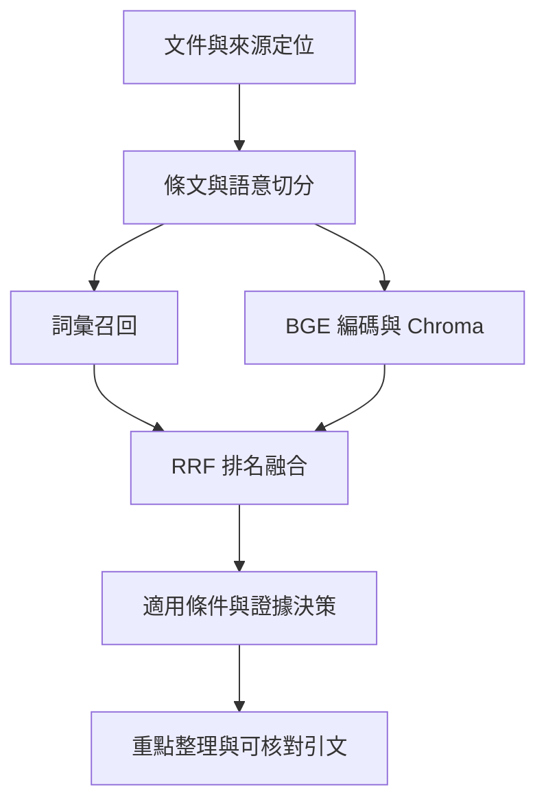

# 架構與資料流程

公開展示與完整本機原型是兩個不同範圍。

| 範圍 | 內容 | 此庫是否能直接執行 |
| --- | --- | --- |
| 公開展示 | 產品落地頁、三組固定示例、原文展開、真實介面截圖 | 是，Python 靜態伺服器即可 |
| 本機問答核心 | 多輪條件、工作階段隔離、引用授權、查詢與回合提交 | 有程式快照；完整執行另需資料與環境 |
| 語料與向量資料 | 文件快照、版本台帳、BGE 權重、Chroma collection | 不在此庫 |

## 文件到檢索

按條文和語意單位切分；同一條的條件、例外與義務盡量保留在一起。每片段保留來源、內容版本與 PDF 頁碼或 HTML 字元定位。字數提示不等於模型 token 限制；本批使用 BGE tokenizer 實測最長 436 tokens，未超過 512 上限，沒有靜默截尾。

| 設定 | 本機原型做法 |
| --- | --- |
| Embedding | BAAI/bge-large-zh-v1.5，1024 維 |
| Pooling | CLS，L2 正規化 |
| 查詢前綴 | 模型的中文檢索 instruction；文件不加 |
| 相似度 | Chroma cosine distance = 1 − cosine similarity；距離越小越相近 |
| 融合 | B0 詞彙、B1 向量各自召回，B2 用 RRF，k=60 |
| 證據決策 | 排名與適用性分開；相似度高不代表對當事人適用 |
| 回答 | 有依據的規則整理與引文，不是生成式 LLM 自由回答 |

未知條件維持未知；不因入學年猜文件適用版本，也不將未查到等同沒有規定。不同版本的衝突需保留關係與對照，不能只取分數最高的一份當現行規則。

## 對話與引用

同一聊天的已確認條件可供後續使用，不同聊天分開。查詢回覆與回合寫入分為兩階段，失敗或取消不當成成功記憶。來源端點檢查工作階段與該聊天是否已取得此引用；不能任意輸入另一聊天的片段識別來讀取。

記憶在服務記憶體內，服務重啟、聊天或工作階段失效後不永久保留。這一版沒有帳號系統、跨裝置同步或永久聊天紀錄。

## 評估不等於適用性證明

主評估題只有 10 題；檢索命中與必要證據組合完整性分開計算。正式首輪顯示融合排序有改善，也顯示前 10 筆可能漏掉必要證據，詳見[產品介紹](product-brief.md)。這不是全校資料涵蓋率，也不是個人法規適用的驗收。
